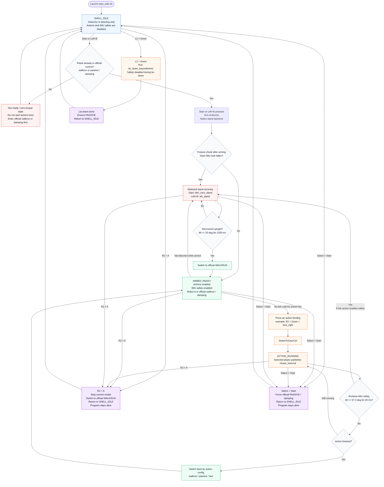

<div align="center">

# ActionGo

**A lightweight action execution and policy switching framework for Unitree G1.**

ActionGo helps you run custom ONNX-based robot actions from the Unitree remote controller, while keeping a safe path back to official `walkrun` / `passive` control.

</div>

---

## What is ActionGo?

`action_go` is a real-robot action execution module for **Unitree G1**.

It is designed for people who want to run different learned robot motions without manually writing DDS / low-level control code every time.

Typical usage:

```text
Official walkrun / passive
        |
        v
ActionGo remote supervisor
        |
        v
SwitchToUserCtrl
        |
        v
ONNX player publishes rt/user_lowcmd
        |
        v
Switch back to official walkrun / passive
```

In simple words:

1. Start ActionGo.
2. Press a remote-controller key combination.
3. The robot executes the selected action.
4. When the action ends, ActionGo switches the robot back to official control.

---

## Highlights

- **Remote-controller actions**: start robot actions with Unitree remote key combinations.
- **Safe default launch**: recommended `start_safe.sh` enables remote supervisor and IMU safety.
- **Automatic switch-back**: actions can return to official `walkrun`, `passive`, or previous mode.
- **Template-based generic runtime**: state, mimic, tracking, sensor, and composite policies use generic players with YAML specs.
- **Generic sensor/composite players**: Instinct Parkour, SteadyTray, and OmniXtreme now use unified spec-driven entrypoints.
- **Structured runtime diagnostics**: supervisor and payload players can write JSONL logs for handoff, runtime metrics, stale input, and safety events.
- **Simulation and smoke tests**: useful scripts are included for testing before real-robot deployment.
- **Modular action packages**: each action family keeps its own models, configs, and documentation.

---

## Supported Actions

ActionGo currently includes these action families and registered actions:

- **BeyondMimic**: `kick_right`, `hlqk`, `wbst`, `lie_down_beyondmimic`
- **UFO**: `ufo_idle`, `ufo_stand`, `ufo_forward_slow`, `ufo_move_left`, `ufo_spin_arms`, `ufo_tracking_zs7`
- **BFM-Zero**: `bfm_zero_stand`
- **Instinct Parkour**: `g1_parkour`
- **Holosoma WBT**: `holosoma_dance`
- **ProtoMotions**: `proto_walk`, `proto_dance`
- **OmniXtreme**: `omni_motion`, `omni_motion_default`, `omni_seg01_*` ... `omni_seg15_*`
- **GentleHumanoid**: `gentle_default`, `gentle_walk`, `gentle_hug`, `gentle_pick_ball`, `gentle_drag_object`, `gentle_move_object`
- **SteadyTray**: `steadytray_balance`, `steadytray_zero_test`
- **unitree_rl_mjlab**: `sim_walkrun`
- **MJLab**: `reverse_vault_flat_mjlab`, `reverse_vault_terrain_mjlab`, `dance1_subject2_mjlab`
- **TWIST**: `twist_offline_pkl`, `twist_nokov_realtime`, `twist_udp_realtime`, `twist_zmq_realtime`, `twist_redis_realtime`

Action details live in each package:

```text
actions/beyondmimic/README.md
actions/bfm0/README.md
actions/ufo/README.md
actions/instinct/README.md
actions/holosoma/README.md
actions/protomotions/README.md
actions/omnixtreme/README.md
actions/gentle_humanoid/README.md
actions/steadytray/README.md
actions/unitree_rl_mjlab/README.md
actions/mjlab/README.md
actions/twist/README.md
```

---

## Generic Policy Runtime

Migrated policies use spec-driven generic players instead of maintaining one
player per model. The supported deployment categories are recorded in the
central `PolicyContract` layer (`runtime/include/action_go/runtime/policy_contract.h`),
which maps each `runtime.template` / `runtime.variant` to the correct generic
player, input source, and output decoding style. Unitree G1 executable
constraints are recorded in `PolicyProtocolConstraint`
(`runtime/include/action_go/runtime/policy_protocol.h`), including motor count,
obs/action dimensions, ONNX I/O names, and fixed source dimensions. A new model
should first be mapped to one of the existing runtime templates:

- `single_actor_state`: UFO, BFM-Zero, unitree_rl_mjlab style state/prompt-conditioned actors.
- `embedded_mimic_time`: BeyondMimic, Holosoma style embedded motion policies.
- `motion_conditioned_tracking`: ProtoMotions, TWIST, Humanoid-GPT style motion-conditioned policies.
- `depth_conditioned_actor`: Instinct style depth encoder + actor policies.
- `object_conditioned_actor`: SteadyTray style object-conditioned policies.
- `composite_motion_policy`: OmniXtreme style multi-model motion pipelines.

The normal onboarding path is to add `actions/<policy>/config/generic_<policy>.yaml`
and point the action YAML to the matching generic player. Edit C++ only when
the policy requires a genuinely new reusable template. See `AGENTS.md` for the
project rules future coding agents should follow when adapting new models.
For a step-by-step reader guide, see
[`docs/new_policy_onboarding.md`](docs/new_policy_onboarding.md).

ActionGo does not claim automatic adaptation from tensor dimensions alone. The
spec must preserve the semantics extracted from training and original deployment
code, including observation order, normalization, joint mapping, action scaling,
runtime frequency, and any sensor or motion source.
Shape-related fields such as `robot.motor_count`, `observation.obs_dim`,
`observation.history_steps`, `action.action_dim`, and template-specific source
dimensions are part of the spec contract; the player validates runtime tensors
against these fields instead of treating G1 dimensions as hidden assumptions.
Run `./build/policy_spec_schema_check --all` before any robot test.

---

## Quick Start

### 1. Build

Default build compiles the core apps, `generic_policy_player`,
`generic_motion_tracking_player`, `generic_sensor_policy_player`, and
`generic_composite_policy_player`. OmniXtreme can run check-only with the
bundled CPU ONNX Runtime; real high-rate OmniXtreme deployment can still use a
separate TensorRT-enabled ORT build. See
[`actions/omnixtreme/README.md`](actions/omnixtreme/README.md) for that
TensorRT build flow.

```bash
cd action_go
cmake -S . -B build
cmake --build build --parallel $(nproc)
```

If ONNX Runtime cannot be found on the robot, use the same ORT directory that
was passed to CMake via `ACTION_GO_ONNXRUNTIME_DIR`.  The launcher scripts
default to `ACTION_GO_ORT_MODE=clean`: they remove ONNX Runtime entries from
`LD_LIBRARY_PATH` and let each player use its own build RPATH.  This supports
split builds where regular players use bundled ORT and OmniXtreme is replaced
with a TensorRT-linked binary when needed.

Manual ORT linkage check:

```bash
env -u LD_LIBRARY_PATH ldd build/generic_policy_player | grep onnxruntime
env -u LD_LIBRARY_PATH ldd build/generic_motion_tracking_player | grep onnxruntime
env -u LD_LIBRARY_PATH ldd build/generic_composite_policy_player | grep onnxruntime
```

If all players were intentionally built against one custom ORT, force global
prepend mode instead:

```bash
export ACTION_GO_ORT_MODE=prepend
export ACTION_GO_ORT=$HOME/onnxruntime-trt-1.19.2
```

For x86 machines using the bundled x64 ORT directly:

```bash
export LD_LIBRARY_PATH=$PWD/thirdparty/onnxruntime-linux-x64-1.22.0/lib:$LD_LIBRARY_PATH
```

---

### 2. Safe Real-Robot Launch

Recommended real-robot entry:

```bash
cd action_go
tools/launch/start_safe.sh
```

This starts the remote supervisor with safety enabled.

The network interface is configured near the top of:

```text
tools/launch/start_safe.sh
```

If your robot uses a different network device, change it there first.

---

### 3. Dry Run

Use dry run when you only want to check configs, commands, and player paths:

```bash
cd action_go
tools/launch/start_dry_run.sh
```

Dry run is useful before testing on the real robot.

Structured runtime diagnostics can be enabled without changing action configs:

```bash
ACTION_GO_EVENT_LOG=/tmp/actiongo_supervisor.jsonl \
  ACTION_GO_NET=lo tools/launch/start_dry_run.sh
```

`ACTION_GO_EVENT_LOG` records supervisor events and passes a per-action payload
JSONL path to generic C++ players via `{event_log_arg}`. The logs are plain
JSONL and can be summarized by external scripts during bringup or experiments.

Runtime handoff and diagnostic interfaces are documented in
[`docs/runtime_architecture.md`](docs/runtime_architecture.md) and
[`docs/remote_supervisor.md`](docs/remote_supervisor.md). Research protocols and
private experiment artifacts are maintained separately from the source release.

---

### 4. Unsafe Launch

Only use this if you know exactly what you are doing:

```bash
cd action_go
tools/launch/start_unsafe.sh
```

---

## Remote Controller Usage

After launching `action_go_remote_test`, ActionGo starts in **shell mode**.

In shell mode:

- ActionGo listens to the remote controller.
- It does not immediately take over the robot.
- Before pressing `Start`, make sure the robot is already in official `walkrun` or `passive / damping`.
- Press `Start` to arm ActionGo with BFM stand recovery, or `Left + B` to arm with UFO stand recovery.
- Press `R2 + A` to stop the current model, switch back to official `walkrun`, and return to `SHELL_IDLE`.
- Press `Select + Start` to switch to damping / passive mode.

---

## Robot State & Button Feedback

The diagram below focuses on the normal remote-control workflow.

Important: before pressing `Start`, the robot should already be in official `walkrun` or `passive / damping`. If the robot is in a zero-torque / not-ready state, remote action keys may appear to do nothing.



Quick interpretation:

- `Start` selects BFM recovery and `Left + B` selects UFO recovery. ARM only enables the supervisor; recovery requires a valid, fresh IMU sample continuously above `fall_angle_deg` for `fall_hold_ms`. With `safety_auto_recovery: false` (default), a fall enters damping and waits for an explicit re-arm. With it enabled, damping may be followed by the selected recovery action.
- If the robot is zero-torque or not in official control, first recover it to `walkrun` or `damping`; otherwise action keys may not respond.
- Above 57.3 degrees, safety enters official damping. Automatic recovery is configurable and disabled by default.
- After recovery, ActionGo switches to official `walkrun` and remembers the selected backend.
- During normal actions, IMU safety can interrupt the action and run the selected stand backend, unless that action disables safety.
- `R2 + A` is the walkrun sleep path: stop the current model, switch to official `walkrun`, and return to `SHELL_IDLE` without quitting the supervisor.
- `Select + Start` forces official damping / passive and returns to `SHELL_IDLE` without quitting the supervisor.

---

## Basic Shell Controls

| Buttons | Meaning |
|---|---|
| `Start` | Arm ActionGo with BFM recovery; run it when tilt is at least 30 degrees. |
| `Left + B` | Arm ActionGo with UFO recovery; run it when tilt is at least 30 degrees. |
| `R2 + A` | Stop current model if any, switch to official `walkrun`, and return to shell/sleep mode. |
| `Select + Start` | Stop current action if any, switch to official passive / damping, and return to shell mode. |

For normal users, use `R2 + A` to sleep in `walkrun`, or `Select + Start` to sleep in passive/damping.
Other low-level exit or debug combinations should not be used as the default operation workflow.

---

## Default Action Bindings

| Buttons | Action |
|---|---|
| `R2 + Down` | `kick_right` |
| `Left + X` | `hlqk` |
| `Left + A` | `ufo_tracking_zs7` |
| `Left + B` | ARM ActionGo with `ufo_stand` |
| `Left + Y` | reserved |
| `F1 + A` | `wbst` |
| `Up + Y` | `g1_parkour` |
| `Right + X` | `proto_walk` |
| `Right + Y` | `proto_dance` |
| `R1 + F1` | `holosoma_dance` |
| `F1 + X` | `omni_seg04_wbst_stand` |
| `F1 + Y` | `omni_seg12_wbst_motive` |
| `F1 + B` | `omni_seg11_side_flip_roll` |
| `L1 + Right` | `twist_offline_pkl` |
| `L2 + Right` | `twist_nokov_realtime` |
| `L2 + Down` | `lie_down_beyondmimic` |

You can change key bindings in:

```text
config/remote_actions.yaml
```

---

## Safety

ActionGo includes an IMU-based safety supervisor.

When the robot tilt angle stays above the fall threshold, the supervisor interrupts the
current action and enters official damping. Automatic stand recovery is optional and disabled
by default. ARM selects the recovery backend but does not bypass the debounce gate:

```text
Start  -> bfm_zero_stand
Left+B -> ufo_stand
```

After the robot recovers, it switches back to official `walkrun`.

Default safety config is in:

```text
config/remote_actions.yaml
```

Important fields:

```yaml
safety_enable: true
safety_auto_recovery: false
shell_start_action: bfm_zero_stand
shell_start_alt_action: ufo_stand
safety_action: bfm_zero_stand
safety_return_mode: walkrun
fall_angle_deg: 57.3
recover_angle_deg: 30.0
fall_hold_ms: 60
recover_hold_ms: 1200
```

Each action can also override safety behavior in its own action yaml.

---

## Project Layout

```text
action_go/
├── actions/                    # action packages
├── config/                     # global action and remote configs
├── docs/                       # detailed documentation
├── runtime/                    # C++ apps, players, source, and headers
├── tools/                      # launch, simulation, export, remote, runtime helpers
└── thirdparty/                 # ONNX Runtime
```

---

## Action Package Layout

Each action family is organized like this:

```text
actions/<action_family>/
├── README.md
├── <action_family>.yaml
├── config/
├── model/
└── motions/
```

For example:

```text
actions/beyondmimic/
├── README.md
├── beyondmimic.yaml
├── config/
└── model/
```

Global action registration is in:

```text
config/motion_actions.yaml
```

Remote key bindings are in:

```text
config/remote_actions.yaml
```

---

## Simulation

Simulation tools are under:

```text
tools/sim/
```

Useful entries include:

```text
tools/sim/action_go_sim.py
tools/sim/action_go_sim_remote.py
tools/sim/instinct_parkour_player.py
tools/sim/protomotions_unitree_mujoco_viewer.py
tools/sim/omnixtreme_unitree_mujoco_viewer.py
```

See:

```text
docs/simulation.md
```

---

## Documentation

| Document | Description |
|---|---|
| `docs/new_policy_onboarding.md` | New reader guide and new ONNX policy adaptation workflow |
| `docs/remote_supervisor.md` | Remote supervisor, safety, UDP control |
| `docs/simulation.md` | Simulation notes |
| `actions/*/README.md` | Per-action setup and usage |
| `docs/runtime_architecture.md` | Runtime contracts, handoff, and diagnostics |
| `DEPENDENCIES.md` | Pinned reference dependency versions |
| `MODEL_ASSETS.json` | Model provenance, hashes, and redistribution gates |
| `CONTRIBUTING.md` | Safety-preserving contribution and validation rules |

---

## Safety Notice

This repository can control a real humanoid robot.

Before running on hardware:

- Make sure the robot has enough free space.
- Keep the robot supported or protected during first tests.
- Always know how to enter passive / damping mode.
- Start with `tools/launch/start_safe.sh` first.
- Do not run high-dynamic actions without checking model, config, and key binding.

Use at your own risk.

---

## Acknowledgements

This project integrates or adapts ideas, models, and tools from several humanoid control projects, including:

- [Unitree SDK2](https://github.com/unitreerobotics/unitree_sdk2) and [unitree_mujoco](https://github.com/unitreerobotics/unitree_mujoco)
- [BeyondMimic](https://github.com/HybridRobotics/whole_body_tracking)
- [BFM-Zero](https://github.com/LeCAR-Lab/BFM-Zero)
- [Instinct](https://project-instinct.github.io/)
- [Holosoma](https://github.com/amazon-far/holosoma)
- [ProtoMotions](https://github.com/NVlabs/ProtoMotions)
- [OmniXtreme](https://github.com/Perkins729/OmniXtreme)
- [GentleHumanoid](https://github.com/Axellwppr/gentle-humanoid)
- [SteadyTray](https://github.com/AllenHuangGit/SteadyTray)
- [TWIST](https://github.com/YanjieZe/TWIST)
- [unitree_rl_mjlab](https://github.com/unitreerobotics/unitree_rl_mjlab)

Model files are not automatically covered by their upstream source-code
licenses. Check `MODEL_ASSETS.json` before copying or publishing any weight;
unknown weight licenses are conservatively blocked from redistribution.
