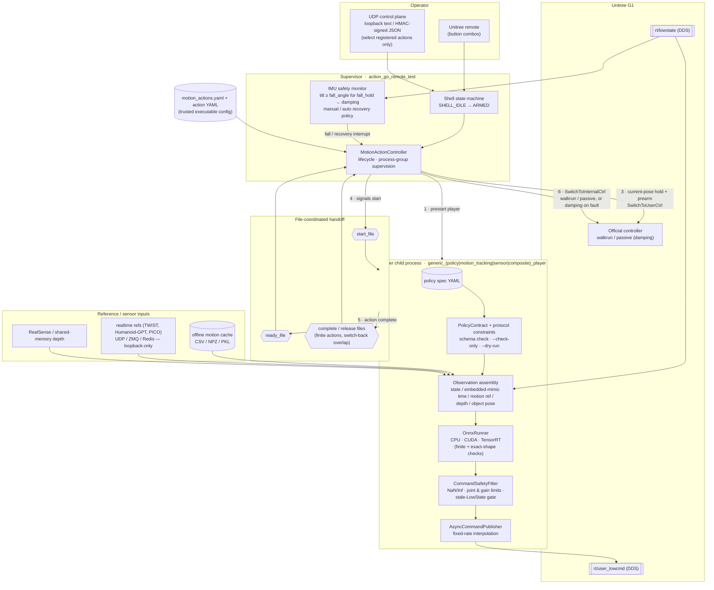

# ActionGo Architecture Diagram

GitHub renders the Mermaid block below natively. To embed it in `README.md`,
copy the fenced block, or export an SVG with
`npx -y @mermaid-js/mermaid-cli -i docs/architecture_diagram.md -o docs/architecture.svg`.

## Reading the diagram

- Everything inside **Supervisor** runs in one process; each **Player** is a
  separate child process in its own process group (`PDEATHSIG`-bound to the
  supervisor), so a supervisor crash cannot leave a payload publishing
  `LowCmd`.
- Steps 1–6 are the nominal lifecycle of one prestarted action. Non-prestart
  actions skip steps 1–2 and publish a prearm packet instead.
- Every normal policy command crosses **CommandSafetyFilter** before
  `rt/user_lowcmd`; the current-pose prearm hold is the only narrowly scoped
  exception and uses fixed validated gains.
- Trust boundaries: action YAML and spec YAML are trusted code; models,
  motion data, UDP/ZMQ/Redis bytes and depth frames are untrusted inputs and
  are validated or bounded before use.
