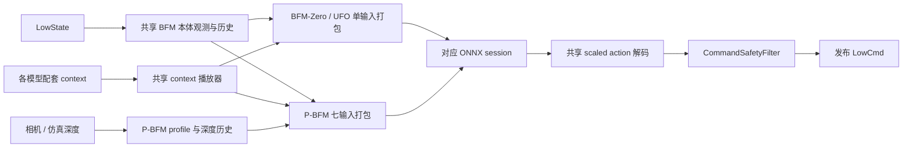

# P-BFM 接入 ActionGo 与 BFM 系列推理复用计划

核查日期：2026-10-19。状态：固定及逐帧 tracking context 已接入运行时，通过 Python/C++ 多步一致性、深度预处理对照、生命周期测试和 loopback MuJoCo 闭环；真实相机、实时遥操与实机仍待验证。本文保留接入前分析，并在第 6 节记录实施结果。

源码位置：`C:\Users\lxj\algo\fighting\P-BFM`，main 提交 `cafdfbdd71640a39b7f091589239d6501ac7f00d`。下文 `P-BFM/` 表示该仓库，其他代码路径相对 ActionGo 根目录。

## 1. 建议结论

BFM-Zero、UFO、P-BFM 应共用本体观测、历史容器、latent/context 播放、动作解码和控制生命周期。模型输入打包、历史采样时点、机器人参数及感知处理应保留明确的契约差异。

当前 UFO 已经使用 `single_actor_state / bfm_zero`，与 BFM-Zero 共用 `generic_policy_player` 及 `runtime/src/generic_policy_module_self.cpp`。这部分复用已经存在。

公开 P-BFM 是带深度的完整推理图，建议归类为 `depth_conditioned_actor / pbfm`，由现有 `generic_sensor_policy_player` 进入共享 BFM 模块。无需新建 `pbfm_player`，也无需因其内部含 CNN、GRU、估计器就归入多模型模板。

第一目标：用现有公开模型、配套固定 context 和仿真深度跑通 ActionGo 闭环。随后接 tracking context，最后接真实相机。Backward、训练框架、reward 搜索和运动 FK 不进入 50Hz 机器人控制循环。

## 2. 已核实的 P-BFM 推理契约

本地 `P-BFM/model/public_demo/` 已有约 144 MiB 的 `policy.onnx`、约 801 KiB 的 `backward_encoder.onnx` 及配套 `config.json`、`contexts.json`。这是公开推理资产，不是可续训 checkpoint；不能直接交给需要 PyTorch checkpoint 的 `python -m pbfm.inference.tracking --model-folder ...`。

### 2.1 在线 Actor

所有输入为 float32，机器人推理使用 batch=1：

| 输入 | shape | 语义 |
| --- | --- | --- |
| `state` | `[1,64]` | `q-default_q(29), dq(29), projected_gravity(3), gyro_body*0.25(3)` |
| `last_action` | `[1,29]` | 上次送入动作解码的 scaled action，不是原始 ONNX 输出或最终安全过滤后的 q |
| `history_actor` | `[1,372]` | 五类量各自此前四帧，按字段分组，各组新到旧 |
| `heading` | `[1,2]` | `[valid*(1-cos(error)), valid*sin(error)]`，目标在左侧时 sin 为正 |
| `velocity_command` | `[1,3]` | 当前机器人 yaw 坐标的 `[target_vx,target_vy,valid]` |
| `depth_image` | `[1,8,18,32]` | 归一化 optical-Z 深度，时间顺序旧到新 |
| `z` | `[1,256]` | 本 checkpoint 配套的行为 latent |

输出：`action[1,29]`、`estimated_velocity[1,3]`。后者是估计的当前速度，不是指令；无需在外部重新估计后反馈给模型。归一化、深度 CNN/GRU、速度估计器和 deterministic Actor 已在 ONNX 内，外部不得重复归一化。

GRU 每次处理输入中的八帧深度，没有对外暴露需要跨控制步维护的 hidden state。

本次用 ONNX Runtime CPU、intra-op=2、inter-op=1、batch=1、5 次预热和 30 次合成输入推理核实接口：均值约 4.12ms、P95 约 4.55ms，两项输出均有限。结果仅代表当前执行环境的单图计算，不包含相机、DDS、调度，也不证明目标机 50Hz 或闭环效果。

### 2.2 机器人与动作

```text
scaled_action = clip(raw_action * 5, -5, 5)
target_q = default_q + action_scale * scaled_action
```

对有限输入，这与当前 BFM/UFO 的 `5 * clip(raw_action,-1,1)` 一致。history 保存 scaled action；关节位置限幅和共享 `CommandSafetyFilter` 位于目标解码之后，保留其现有职责。

- 控制周期为 0.02s，即 50Hz；官方演示物理周期为 0.005s，decimation=4。ActionGo 的 500Hz 命令发布是待验证的部署设置，不能表述为上游训练频率。
- 29 个 joint name 的顺序及 default pose 与当前 BFM/UFO 参数一致；实机仍按 ActionGo 的 G1 motor mapping 核对 IMU 坐标和关节方向。
- P-BFM 的 kp/kd、action scale 与当前 UFO 在 `1e-4` 比较容差内一致；BFM-Zero 的四个 wrist pitch/yaw 参数明显不同。例如 P-BFM wrist pitch/yaw kp=8.61103、kd=0.5482、scale≈0.38904，BFM-Zero 对应值约 16.77833、1.0681、0.0745。
- 力矩上限不能直接共用：公开 P-BFM 配置的 hip pitch/roll 为 139Nm、wrist pitch/yaw 为 13.4Nm；当前 UFO 参数分别为 88Nm、5Nm。最终实机限值需要核对 G1 硬件版本与现有部署约定；仿真模型参数和硬件安全上限分别记录，不随复制参数而放宽。

### 2.3 最容易误用的历史时序

字段顺序相同：`actions, base_ang_vel, dof_pos, dof_vel, projected_gravity`；每个字段四帧，共 `4*(29+3+29+29+3)=372`。

但两条现有路径的更新时点不同：

| 路径 | 构造第 t 步输入时的 history |
| --- | --- |
| ActionGo 当前 BFM/UFO | 先 push 当前观测，再构造输入，历史含当前观测 |
| P-BFM MJLab 与公开部署配置 | 先 query 历史构造输入，再 append 当前观测，历史是此前四帧 |

因此应复用容器与字段构造，显式区分 `include_current` 和 `previous_only` 两种采样语义。抽取代码时保持已有 BFM/UFO 输出不变，不借本次接入顺带改变旧路径。

P-BFM reset 将本体历史清零，首次构造观测后再追加当前帧。不能照搬 BFM 当前五步 warmup 就声称等价；启动和 preview 分别核对首个有效输入与 history 状态。

### 2.4 深度契约

公开模型采用 `optical_z_maxcrop18_reset_v2`：

1. 相机提供 optical-Z 米值；RealSense 原始零值无效像素先转 NaN，再按该 profile 填 2.5m。仿真 ray range 先转换成 optical-Z。
2. 目标源图为 `36x64`，保留训练相机的视场和像素约定；裁剪 `[top=18,bottom=0,left=16,right=16]` 得到 `18x32`。
3. 采用 3x3、sigma=1 Gaussian，reflect padding，裁剪到 `[0,2.5]`，按 `/2.5*255` 舍入为 uint8。
4. 在 50Hz 控制时间轴维护 37 帧环形历史，抽取 ages `[35,30,25,20,15,10,5,0]`，覆盖 0.7s。reset 用首个有效图填充历史。
5. ONNX 边界做 uint8 → float32 `/255`，仅转换一次。已经归一化的 float 不再除以 255。

八张图间隔 0.1s 不代表上游只维护一个 10Hz 历史；真实 30Hz 相机要依据时间戳映射到控制时间轴，不能每次收到新图就把 history index 当作推进了一个 20ms 控制步。

源码的训练相机挂在 `torso_link`，mount position 约 `[0.048799,0.01,0.437803]`m，水平/垂直 FOV 约 `89.51°/58.29°`；精确姿态见 `RP1DirectDepthConfig.optical_quat_torso_xyzw`。真实相机内外参、安装位置和时钟同步仍需现场标定。

ActionGo 的 `SharedMemoryDepthStream` 可复用为仿真/外部 producer 的传输层；现有 PHP 的 `58x87`、`[-0.5,0.5]` 预处理不能用于 P-BFM。Instinct 的相机采集方式可参考，但 profile、时间采样和初始化须单独匹配。

### 2.5 行为 context

P-BFM 的指令单位是 `(z, heading target, velocity target, validity, dt)`，不能只复制一份 `z.npy`。

- `velocity_command=[0,0,1]` 是明确要求停住；`[0,0,0]` 是不指定速度。恢复、原地动作不能统一填 valid zero。
- tracking 将参考 heading 和 root velocity 在动作开始时按机器人 yaw 做一次固定对齐，然后每步转换成当前 yaw 坐标。不能每帧重置 world target 使 heading error 永远为零。
- reward 的 `move-ego` 速度可直接采用当前 yaw 坐标指令；tracking 的 heading0-relative 速度必须转换后再作为模型输入。这两种 context 保留各自明确的 frame 标记。
- `P-BFM/pbfm/inference/runtime.py::_tracking_z` 使用未来窗口均值后投影；公开说明为八帧。现有 UFO 导出器为三帧、gamma=0.8，不能直接用于 P-BFM。
- 256 维仅表示尺寸相同；三个 checkpoint 的 latent 数值不能互换。每个动作包保持自己的模型、encoder 和 context 来源关联。

本地已有 5 个 reward preset、21 个 goal context；`contexts.json` 中的 10 个 tracking 条目只是索引。初查时 `model/public_demo/tracking/*.json.gz` 散文件缺失；后续已从本地 Git 的固定 pages 提交对象中取得官方 LaFAN/SOMA tracking 文件。公开默认 preset 是张臂 0.8m/s 前进，不是自然行走或 idle。第一阶段选用配套固定 context 做受控仿真，不能自动生成或宣称已有 `pbfm_stand` 恢复能力。

Backward 实测签名为 `state[B,64] + privileged_state[B,463] → z[B,256]`，导出源码 wrapper 中的 `last_action` 已被该图优化消除。privileged_state 是参考运动/FK 的训练约定特征，不是实机必须增加的传感器；它适合离线生成 context cache。新 checkpoint 仍以实际导出图和 metadata 为准。

## 3. 共用边界与代码落点

以下为拟新增模块名，不代表当前已经存在。

| 模块 | 共用内容 | 必须保持独立的部分 |
| --- | --- | --- |
| `bfm_observation.h/.cpp` | 64D state、scaled previous action、按字段分组的 history 容器 | history 更新时点、初始化和输入布局 profile |
| `bfm_action.h/.cpp` | raw→scaled action→target q、参数加载及 motor mapping 接口 | 每个 checkpoint 的 PD、scale、limits 和硬件上限 |
| `bfm_context.h/.cpp` | 固定 context / cache 播放器、时间推进、结束行为 | latent 所属模型、heading/velocity frame、有效性、窗口算法 |
| `pbfm_policy.h/.cpp` | P-BFM 七输入 ONNX session、输出校验与速度诊断 | 完整图输入绑定；不复制训练网络或拆开 ONNX |
| 深度 source/profile | 采集、SHM、时间戳和 stale 检查基础设施 | P-BFM 的 optical-Z、crop、量化和八帧抽样 |
| BFM 控制 runner | current-pose hold、ready/start、50Hz 推理、发布、切回与日志 | 通过模块提供 state/context/depth 和模型推理 |

共享代码位于 `runtime/include/action_go/runtime/` 和 `runtime/src/`。保留现有 `bfm_zero` variant 和 BFM/UFO action 名；新增 `pbfm` variant。`PolicyContract`、`policy_protocol`、schema checker 一起扩展，所有尺寸与采样字段在 spec/参数中明确声明，由集中约束校验。

接入前 `generic_sensor_policy_player` 的深度分支直接进入 Instinct runtime。现已增加 P-BFM 模块分发，复用抽出的 BFM runner；P-BFM 不经过要求 `depth_encoder.onnx + actor.onnx` 的 Instinct 加载器。首轮未迁移全部旧 sensor runtime。

推荐数据流：



## 4. 分阶段实施

### 阶段一：提取已有 BFM/UFO 公共部分

- 从 `generic_policy_module_self.cpp` 提取本体观测、history 和动作解码；旧 spec 的行为保持原样。
- history profile 显式表达采样时点。使用有变化的多步 state/action 序列验证，避免常量输入掩盖一帧错位。
- 抽取 BFM 控制 runner 时保留现有 ready/start、preview、回切和 event log 行为；避免新增一份复制的控制循环。
- 验收：同一 LowState replay 下，重构前后 BFM/UFO 的 actor_obs、raw action、target q、kp/kd 和最终安全过滤结果一致。

### 阶段二：P-BFM 固定 context 与离线一致性

- 新建 `actions/pbfm/`，从官方 config 生成独立 `PBFM.yaml`，保留模型来源和参数差异说明。
- 导入公开 ONNX 与配套 preset/context；不重新导出网络，也不借用 UFO latent。
- 实现 `pbfm_policy` 七输入 session 和 `previous_only` history profile。
- 在 `PolicyContract` 注册 `depth_conditioned_actor / pbfm`，同步协议维数、schema 和 sensor dispatcher。
- 用同一组多步 state、depth、context 输入比较 Python oracle 与 C++ 的各项 feed、raw action、estimated_velocity、scaled action 和 target q。模型计算可先采用上游 FP32 比较容差 `atol=rtol=2e-4`，协议布局和索引必须严格一致。
- 首期 schema 以 named inputs 和独立维数表达 64、29、372、2、3、`8x18x32`、256，不能只造一个总 obs_dim 就当作完整契约。

### 阶段三：ActionGo 仿真闭环与生命周期

- 通过现有 `generic_sensor_policy_player` 调用共享 BFM runner；保持 50Hz inference，验证拟采用的 500Hz publish 设置。
- 仿真 producer 依照 P-BFM 相机几何生成深度，经 P-BFM profile 输入；先平地固定 preset，再验证转向、移动及地形。
- 模型、context、LowState 和有效深度就绪后才报告 ready；prestart 发布 current-pose hold，等待 start 后推进动作时间。
- 起始 yaw 在实际动作开始时确定。preview 使用独立可回滚状态，覆盖本体历史、last_action、context index 和 yaw 对齐；preview 不消耗正式参考帧。实时传感器时钟不回滚，commit 前检查输入新鲜度。
- 所有 LowCmd 仍通过 `CommandSafetyFilter`。相机缺失/掉流、LowState 过期、模型输出非有限值按现有机制退出/阻尼或交回 supervisor，不能继续盲跑。
- 保留 `{event_log_arg}`、ready/start 与 switch-back；首期只新增可显式调用的动作，不占用已有遥控键、不注册为默认恢复后端。
- preview 的能力声明与实际通过的生命周期测试同步；尚未实现时不能在 contract 中声称支持。

### 阶段四：tracking cache 与真实相机

- 已从固定 pages 提交对象取得公开 checkpoint 配套的 tracking 文件；自行生成新动作仍需正确 Backward 参考特征，不能用 UFO 的 `zs_7` 顶替。
- cache 保存 `z[T,256]`、heading-relative、reference velocity、valid flags、dt、坐标约定与结束行为；z/heading/velocity 共用一个 frame index。
- 当前实现选择显式 YAML frame sequence，直接导入官方已编码 z 和命令；未增加 NPZ 读取支持。
- tracking 默认先单次播放并回切。若增加循环，要同时处理参考 heading 的累计转角、速度旋转和边界，不只对 z index 取模。
- 真实相机核对内外参、光轴、视场、invalid 处理和时间戳；做 camera-only 检查，再接 DDS dry-run，最后才进入受控实机验证。
- 任意 reward 的在线搜索和 realtime mocap context 延后；固定 preset 与离线 cache 跑通不依赖完整训练 checkpoint。

## 5. 语义来源与 ActionGo 映射

以下新字段是设计要求，具体命名在实施时与现有 schema 对齐。

| field / semantic | 来源文件或配置键 | 提取值 | ActionGo 落点 | 可信度 / blocker |
| --- | --- | --- | --- | --- |
| 分类 / 模型组成 | `P-BFM/pbfm/inference/export/depth_policy.py` | 完整 direct-depth actor，含 normalizers / estimator | `runtime.template=depth_conditioned_actor`，新增 variant | 已核实源码和图 |
| ONNX I/O | 本地 `policy.onnx` 与 `config.json` | 七输入、两输出，表见 §2.1 | `model.input_names/output_names` 与逐输入 shape | 本次 ORT 实测 |
| state 拼接和缩放 | `P-BFM/pbfm/envs/mjlab/observations.py::get_observation`；`obs/bfm_zero_obs.yaml` | q_rel,dq,gravity,gyro*0.25 | 共享 observation profile | 已核实；实机 IMU frame 待对照 |
| history | 同文件 `_raw_actor_obs`；`history.py`；公开 `provenance.historyContract` | 分组、新到旧、此前四帧 | history_steps=4，新增 timing profile | 已核实，与旧路径有差异 |
| action 及历史动作值 | `P-BFM/pbfm/envs/mjlab/core.py::_normalized_action`；公开 `provenance.actionContract` | clip(raw*5,-5,5)，保存 scaled action | 共享 decoder；rescale、clip、add_default | 已核实 |
| default q / joint order / PD / scale | `P-BFM/model/public_demo/config.json` | 29 个 joints 及逐关节数组 | 独立 `robot.params=PBFM.yaml` | 已核实；不能复制 BFMZero.yaml |
| 力矩 / 关节限制 | 同 config 的 `effortLimit/jointRanges`；训练 robot control | 与现有 UFO 部分上限不同 | 参数来源与 hardware safety limits 分开记录 | 真实硬件限值待确认 |
| control dt | 同 config 的 `controlDt/physicsDt/controlDecimation` | 0.02 / 0.005 / 4 | inference_hz=50；发布频率另验 | 已核实 |
| depth profile | `P-BFM/pbfm/configs/depth_contract.json`；`perception/instinct_direct_depth.py` | maxcrop18、2.5m、37 帧环、八帧抽样 | sensor profile、shape、history 配置 | 已核实 |
| camera frame | 同文件 `RP1DirectDepthConfig`；`realsense_depth_runtime.py` | torso mount / optical-Z / 标定接口 | sensor calibration | 训练约定已知；实机标定待完成 |
| heading / velocity | `P-BFM/pbfm/agents/behavior_context.py`；`inference_context.py` | heading error、当前 yaw 速度与 validity | context source 和 frame metadata | 已核实 |
| tracking z / context 对齐 | `P-BFM/pbfm/inference/runtime.py::_tracking_z`；`inference/tracking.py` | future-window mean/project；一套 action frame index | 离线 context exporter/cache | 公开说明八帧；新 checkpoint 读取自身配置 |
| fixed contexts | `P-BFM/model/public_demo/contexts.json` | 5 presets、21 goals | 首期 context 文件 | 可用；不等于已验证恢复 |
| tracking assets | 同文件 `tracking[].file`；固定 pages 提交 `interactive/pbfm/tracking/*.json.gz` | 每帧 z、heading、velocity，dt=0.02 | `tools/export/import_pbfm_tracking.py`、`BfmContextSequence` | 本地 Git 对象已提取并验证行走 cache |
| startup / handoff | ActionGo BFM loop、sensor runtime 与共享安全模块 | current hold / ready-start / switch-back | 共享 runner 与 action YAML | loopback hold/start 与深度断流已测；supervisor 实机切换待测 |

## 6. 验证与交付边界

本次在 `feature/generic-policy-runtime` 完成首期软件接入，保留工作区原有本地变更。新增共享 `bfm_observation`、`bfm_action`、`bfm_context`，BFM-Zero/UFO/P-BFM 复用原 BFM 控制循环。P-BFM 注册为 `depth_conditioned_actor/pbfm`，通过已有 sensor player 进入该循环；模型、参数、五个 context、动作和 schema 均已接入。没有启动训练或真实机器人控制。

以下检查已通过：

```bash
./build/policy_spec_schema_check --all
./build/generic_policy_player --spec actions/bfm0/config/generic_bfm_zero.yaml --check-only
./build/generic_policy_player --spec actions/ufo/config/generic_ufo_stand.yaml --check-only
./build/generic_sensor_policy_player --spec actions/pbfm/config/generic_pbfm.yaml --check-only
ACTION_GO_NET=lo tools/launch/start_dry_run.sh
```

全局 dry-run 在 `lo` 上正常加载 88 个动作并等待 LowState，6 秒后主动中断；该项仅验证 supervisor 启动，不代表自动执行了 P-BFM。

专项验证：

- BFM-Zero、UFO、三个 P-BFM context 各 24 步，共 120 步 Python/C++ 回放通过，比较全部 observation feed、动作、估计速度和目标 q；包含 heading validity。原 BFM preview commit/discard 回归通过。
- 32 张含无效值的深度图与上游纯预处理函数逐像素 uint8 完全一致；37 帧环的 reset、age 与八帧时间顺序通过测试。
- 缺深度在 ready 前失败；ready/start 正常；待启动/活动断流、范围错误失败；文件输入拒绝真实发布。断流阈值 0.2 秒，异常阻尼沿用共享路径。
- 首次 3 秒平地 loopback 闭环（物理步长 0.005 秒）：150 次推理，pelvis 最低 0.7768 m，末态 0.7863 m，未跌倒。包含 trace 的推理阶段累计均值 5.80 ms；policy deadline miss=0，publish deadline miss=26，最大发布间隔约 9.69 ms。当前主机未达到严格 500 Hz 发布时序；不能将此结果写成目标机时序保证。
- 断流复核使用 0.001 秒积分步长：停止深度后非零退出，实际 DDS 最后一条 LowCmd 为 `kp=0,kd=3` 阻尼；距最后深度至进程退出约 0.368 秒，包含 stale 判定和阻尼退出。0.005 秒粗步长下曾出现阻尼数值不稳定，保留为仿真限制，不作为通过结果。
- 最终 10 秒平地 loopback（积分步长 0.001 秒）：500 次推理、约 10.02 秒物理时间，pelvis 最低 0.7766 m、末态 0.7870 m，状态有限且无自动重置。policy deadline miss=0，publish deadline miss=139，最大发布间隔约 8.64 ms。原始日志位于本地 `outputs/pbfm_smoke_10s/`，断流复核位于 `outputs/pbfm_smoke_dropout_dt001/`。

复现命令、依赖和参数语义见 `actions/pbfm/README.md`。真实相机标定、实机 IMU frame/吊架/切换、板载 50/500 Hz 时序、实时遥操和 backward 离线导出仍待完成。P-BFM 为 non-core 扩展，不改变论文八个核心 policy family 的统计口径，也未实现事务 preview。

### 地形前进演示

使用 `forward08-arms-spread` 原始 context（0.8 m/s 指令），在前方 1.8 m 加入
五级 12 cm 高、30 cm 深的上行台阶、80 cm 平台与下行台阶，地形同时参与碰撞和深度感知。
运行的是 ActionGo C++ 七输入推理与共享安全过滤，未用参考轨迹替代控制。

- 首轮通道宽 2.8 m：机器人登上台阶后在侧缘失衡跌落，随后重新站起；保留在本地
  `outputs/pbfm_stairs12_forward_demo/`，不计作稳定通过。
- 加宽至 6 m 的复测：14 秒完成 700 次推理，最终位置约 `[8.984,-2.000,0.752]` m，
  经过上行、平台、下行后继续前进；起步约 2 秒有一次失衡撑地。最低 pelvis 0.390 m，
  状态有限且未自动重置。存在横向漂移和起步稳定性问题，不能表述为稳定地形通过率。
  完整录像、spec 与事件保留在 `outputs/pbfm_stairs12_forward_wide/`。

上述仅为两次本地 MuJoCo 演示，不属于实机或统计实验结果。

### 自然行走与遥操边界

新增 `tracking_heading0_yaw_velocity_v1` context：每帧保存原始 z、相对启动 yaw 的
heading、heading0 参考速度及 valid，dt 固定 0.02 秒。start 前验证不消耗参考帧；
正式控制每步同步推进三者，速度旋转到当前 yaw 坐标，末帧后正常结束，不复用末帧。
新生命周期回归实际验证三帧依次输入模型、ready/start 不跳帧和末帧退出。

`lafan-full-walk1-subject5` 原始参考含张臂准备及多次转弯。18 秒 / 900 帧闭环完成，
最终位置约 `[-1.663,-1.726,0.788]` m，最低 pelvis 0.496 m，有明显低蹲；
不作为稳定直行示例。trace 与原始 context 独立核对 900 帧：z 误差 0，
heading 最大绝对误差约 3.39e-7，velocity 约 1.39e-7，索引连续。
证据位于 `outputs/pbfm_natural_walk_demo_run2/`。

参考官方交互网页的速度/航向覆盖语义，在导入时固定速度 0.6 m/s、相对启动航向 0°，
保留原始逐帧行走 z。平地 14 秒 / 700 帧完成，最终位置约 `[6.671,1.766,0.736]` m，
最低 pelvis 0.645 m，视频中约第 3 秒后手臂放下并持续迈步；仍有明显侧漂。
policy deadline miss=0，publish deadline miss=118，最大发布间隔约 12.95 ms；
不是严格 500 Hz 时序保证。证据位于 `outputs/pbfm_natural_forward_demo/`。

相同行走 z 与固定速度/航向在五级 12 cm 台阶上复测 14 秒 / 700 帧，最终位置约
`[7.113,0.936,0.702]` m，经过上行、平台和下行；下行末端约第 12 秒仍有失衡撑地，
最低 pelvis 0.406 m，不能作为稳定通过。完整录像和日志保留在
`outputs/pbfm_natural_forward_stairs_demo/`，不裁去失衡片段。

官方项目页确有 Teleoperation 展示，公开主仓库的推理入口为 tracking / goal / reward；
本次未发现完整的实机遥操采集与部署链路。交互网页可实时覆盖 heading/speed，证明该模型
有速度与航向条件接口；后续已新增 ActionGo 的 LowState 遥控轴条件覆盖与 MuJoCo 键盘入口，
实时人体动作输入和实机遥操仍未接入。普通 `move-ego` reward latent 的重新生成需要原始模型和
replay buffer，现有公开 ONNX 资产不足以直接完成；不能用张臂 latent 改个名称冒充。

本次公开 context schema 从固定扩展为逐帧序列，因此同步了中文工作稿与 `EXPERIMENTS.md`；
真实相机、板载时序和实机能力仍保持待实验，不增加统计实验结论。

### 在线键盘速度与转向

新增显式 `context.command_source=wireless_remote`，从 LowState 的 LY / −LX / −RX
读取前进、侧移和转向，使用 spec 四项速度上限；50 Hz 积分目标 yaw，覆盖模型的
heading 和有效速度条件，z 仍使用当前 tracking 帧。旧 context 默认行为保持原样。
MuJoCo 的 `--keyboard` 将按键写入已有 DDS 遥控轴，无额外端口；Enter 开始、
键盘现已改为摇杆式：按住 W/S 前进/后退、A/D 持续转向、Q/E 侧移，松开对应轴立即归零，
窗口失焦时全部归零；空格覆盖为零指令，X 退出。前进 0.6 m/s、后退 0.3 m/s、侧移
0.4 m/s、转向 1 rad/s。使用 GLFW 按下/松开事件，不再使用速度累加或定时转角。
模型仍接收有效速度条件，松键发送 `[0,0,1]`，实际停止由策略和物理动力学决定。

本地八秒 / 400 帧实际 DDS 闭环验证：前进条件为 0.6 m/s，A 键使目标航向左转
约 14.90°，空格后模型速度输入为 `[0,0,1]`；动作有限，pelvis 最低 0.691 m。
证据位于 `outputs/pbfm_keyboard_validation/`。生命周期回归新增遥控轴为零时
覆盖 cache 原始命令、保持逐帧 z 与末帧结束的检查。该结果仅验证仿真控制入口，
不代表任意速度/转向下的稳定性或实机遥操能力。

### LaFAN 跑步试播

按用户请求切换官方 `lafan-full-run1-subject5`，保留原始 z、heading、velocity，
未启用键盘覆盖。前 24 秒 / 1200 帧完成实际 DDS 闭环；参考约第 6 秒开始明显跑步，
该区间原始参考速度约 1.7～2.7 m/s，局部超过 3 m/s。当前闭环多次失衡跌倒后重新站起，
最低 pelvis 0.159 m，末态约 `[-8.401,4.115,0.774]` m；不能称为正常跑步复现。
schema 和 check-only 通过，仅说明接口/加载正确，不证明动态跟踪质量。
证据位于 `outputs/pbfm_lafan_run_demo/`，另渲染官方 `referencePose` 运动学回放作为
对照；该参考回放不经过策略或物理控制，不能充作 ActionGo 推理效果。

### 官方 sim2sim 对照与修复

官方 `docs/INFERENCE.md` 明确提供 `pbfm.inference.tracking/goal/reward` 原生入口，
tracking 可选择地形并输出 reference / policy 对照视频。它使用 MJLab / MuJoCo-Warp，
需要原始 checkpoint 和 motion 数据；本地目前只有公开 ONNX 资产，原生 CLI 未运行。
另实际运行官方 `https://roboparty.github.io/P-BFM/interactive/` 的 MuJoCo WASM + ONNX
闭环，选择 `run1_subject5`、Flat、row 4，不覆盖速度/航向；20 秒画面中机器人保持跑姿，
显示速度 2.46 m/s，29 秒时暂停。不能仅凭瞬时截图声称整个官方片段无跌倒。

已确认并修复以下仿真问题：

| 语义 | 官方来源 / 值 | 此前差异 | 修复 / 证据 |
| --- | --- | --- | --- |
| 相机外壳遮挡 | `interactive/assets/depth-BJV-tJSc.js` 排除 torso 上 head_link mesh | 576 个裁剪像素全部命中约 0.0117 m 的外壳 | raycast 临时排除并恢复 group；真实几何回归通过 |
| 平地接触几何 | `interactive/pbfm/robot/scene.xml` 使用实体 box 平地 | 简化成无限 plane | 改为顶面 z=0 的 box；单变量消融见下文 |
| 电机与物理参数 | `physics-DlpedSvE.js` DC 速度力矩包络；scene 的 implicitfast、0.005 s、Newton100 | 固定力矩截断、Euler、0.001 s | 仿真桥逐子步包络；同步 solver / timestep，并刷新派生常数 |

新增 `tools/sim/diagnose_pbfm_sim2sim.py` 独立原生 MuJoCo / ONNX 对照，直接提取固定 pages
提交资产，不通过 ActionGo / DDS。`outputs/pbfm_sim2sim_contract_v2/` 中修复相机后的 plane
基线 24 秒最低骨盆 0.0919 m；`outputs/pbfm_sim2sim_box/official/` 仅将地面改为 box，
最低 0.5503 m、没有低于 0.45 m 的阶段。对齐初始 yaw 的 box 复测最低 0.5532 m。
完整官方场景对照 `outputs/pbfm_sim2sim_public_scene/` 最低 0.5636 m，亦无低于 0.45 m 的阶段。
这里的高度阈值仅作诊断，不是官方 fall 指标。更早 `outputs/pbfm_sim2sim_diagnosis/` 中
诊断脚本的 gravity 符号有误，该目录无效，不用于任何结论。

官方场景下逐项启用 target joint clamp、20 ms 插值、旧积分方式，三个 24 秒短片均未出现
低于 0.45 m 的阶段，证据在 `outputs/pbfm_sim2sim_public_ablation/`。因此目前不能把目标限位
或插值单独判定为这次跌倒的原因，也未为追求效果放宽 C++ 安全限制。官方模型约四成控制步
存在超出物理关节范围的 PD target，这是仍需记录的执行器语义差异，不代表真实关节已越界。

将相机、地面和物理修正接回 ActionGo 后，实际 DDS 闭环 `outputs/pbfm_run_sim2sim_fixed/`
完成 1200 次推理、约 24.03 秒物理时间，最低骨盆 0.5655 m，末态高度 0.6440 m，未再跌倒。
policy deadline miss=0，publish deadline miss=210，最大发布间隔 10.36 ms；仍不满足严格
500 Hz 时序保证，亦非与官方逐步完全等价。新物理设置下断深度复测约 0.335 秒后退出，
最后一条实际 LowCmd 为 `kp=0,kd=3`，骨盆最低 0.7798 m，无仿真重置。
`bfm_policy_test`、`pbfm_depth_test`、`pbfm_onnx_parity`、`pbfm_lifecycle_test` 全部通过。

此前行走、台阶和跑步视频使用被外壳遮挡的深度及旧地面/物理设置，保留作失败记录，
不能再作为该模型能力的判断依据。本次为仿真 bug 修正，不变更 handoff、schema、硬件安全
边界或研究统计口径，因此不重写论文与实验协议。长时跑步、台阶和实机仍待重新验证。

### 按住行走、松开站立：2026-10-19

此前键盘只把 heading/velocity 命令归零，LaFAN 行走 z 仍继续播放。
`outputs/pbfm_keyboard_hold_stairs_20261019/trace.jsonl` 中零指令持续约 15.8 秒，
估计水平速度仍约 0.56 m/s；该现象不能解释为短时惯性，早期“零速度条件”测试不能证明停步。

本次新增显式 `context.idle_path`、`context.command_deadband`。全部轴处于死区时，
策略切换到站立 z 与 `[0,0,1]`，暂停行走参考，并在松键时锁定当前 yaw；有效按键恢复参考。
该交互模式的参考末帧循环，普通 tracking 播放仍到末帧结束。站立资产在 ready 前加载、
检查并完成 ONNX 推理；共享 LowCmd 安全过滤、实时深度/LowState freshness 和 ready/start 保持有效。

| 语义 | 来源 | 提取值 / 实现 | 验证范围 |
| --- | --- | --- | --- |
| 静止目标 | 公开 `config.json.defaultJointPosition`、`g1_29dof.xml` | 默认关节角、初始根高度 0.793 m，所有目标速度为零 | 离线生成；不是官方五个 reward preset |
| backward 特征 | pages `671fbafe71a5f58bab77eeb5d969051fd2d283f4` 的 `interactive/assets/motion-import-uImOWE3z.js` | pelvis、29 个 link、torso 上方 0.35 m 虚拟 head；相对位置、X/Z 轴 6D 朝向、线/角速度，共 463D；state 64D | `tools/export/export_pbfm_idle.py`；目标 yaw=0 |
| 静止 latent | 配套 `model/public_demo/backward_encoder.onnx`、`inference/export/backward_encoder.py` | 内置 normalizer，输出 256D、范数 16，保存 `context_idle.yaml` | 在线仍只运行完整 policy ONNX |
| 按键切换 | `generic_policy_module_pbfm.cpp` | 50 Hz 判断三轴，死区 0.05；静止不推进行走帧 | trace 记录 motion_state/reference_step，实际 DDS 检查 |

实际 loopback DDS + MuJoCo + 0.12 m 台阶场景运行 26 秒，按 W 的区间为 2–6、10–13、17–21 秒。
完成 1300 次推理；三次松键后水平速度连续 0.5 秒低于 0.08 m/s 所需时间分别为
0.80、1.14、1.18 秒，松键至下次按键/结束的净位移分别为 0.156、0.317、0.230 m。
松键一秒后的平均实测水平速度分别为 0.0139、0.0190、0.0180 m/s，主要是站立调整。
最低骨盆 0.739 m，末态 1.269 m，机器人到达上方台阶并停留；状态有限、没有物理重置。
全过程未冻结关节、未清零 qvel、未直接改写运行中的 qpos。
证据与视频：`outputs/pbfm_keyboard_stop_stairs_20261019/`；`movement.npz` 为 MuJoCo 真值，
与速度估计器及指令分别记录。trace 确认三次松键后行走参考索引分别停在 200、350、550。

另 16 秒短按/转向复核：0.3 秒短按 W 松开后收步约 0.36 秒；2 秒 W 松开后约 0.52 秒；
1 秒 A 转向松开后约 0.72 秒。最后 4 秒平均绝对 yaw rate 为 0.0035 rad/s。
证据：`outputs/pbfm_keyboard_stop_short_turn_20261019/`。
短时收步与小幅站立调整仍存在，不能承诺瞬时物理静止或任意地形/速度下的停步保证；实机未验证。

相关 5 项 CTest、全量 31 个 spec schema、启用 idle 的 check-only 均通过。
生命周期新增站立缺失时不能 ready、静止时不耗尽行走 cache 的回归。
`ACTION_GO_NET=lo tools/launch/start_dry_run.sh --startup-delay-sec 0` 成功加载 88 个动作，
无 domain 0 LowState 时等待输入，12 秒后主动结束；未执行实机接管。
本次改变公开 context/参考推进语义，因此同步中文论文工作稿与 `EXPERIMENTS.md`，不增加核心 family 或实机结果。

### 零转向按键仍偏航：输入条件修正

上述首版解决了停步，但仍使用完整 LaFAN 行走参考。核对发现前进键未写入 RX 转向轴，
却在约第 200–300 帧遇到参考航向从约 -7° 转到 -176°；覆盖 heading/velocity 并未清除 z 中的
转弯动作条件。此前 26 秒按键试验的机身 yaw 在一次 W 前进中达到约 61°。
此外，首版在松键时把目标 yaw 重新锚定到已偏航的当前机身角度，重复按放可能累计方向偏差。

现在键盘入口不再使用该 LaFAN z，改为 `context.directional_paths` 显式指定前/后/左/右固定 goal，
`context.idle_path` 指定站立。`export_pbfm_idle.py --keyboard-contexts` 使用同一公开 backward encoder
及官方特征布局，生成 `context_keyboard_{idle,forward,backward,left,right}.yaml`：默认关节姿态、
根高度 0.793 m、全零目标关节/角速度；所有 link 的目标世界平移速度分别设为
`(0,0)`、`(0.6,0)`、`(-0.3,0)`、`(0,0.4)`、`(0,-0.4)` m/s。归一化 latent 维度与范数不变。
各资产保存 encoder、特征代码、checkpoint、目标姿态和目标速度来源；它们是自行编码的 goal，
不是官方新发布的 reward preset。

按键运行时选择方向 goal；斜向对两个 latent 按相对指令强度加权后恢复原范数。
仅按 A/D 时使用站立 z 和有效零平移速度，全部松键时继续站立。
目标 yaw 在 start 时初始化，之后仅由 RX 转向轴积分，松键不修改目标 yaw。
trace 新增 `command_axes` 和 `command_yaw`，可区分真实按键输入、目标变化与实际模型偏航。
四个方向资产均在 ready 前加载并完成 ONNX 校验；缺失方向资产不能接管。
普通 tracking 播放、未配置方向 goal 的 spec 仍使用既有 tracking 语义；键盘不再需要 motion cache。

原生仿真对照前 30 秒采用相同模型、初态、box 地面、深度、PD 插值和固定航向/0.6 m/s 指令，
只改变行走 z：原完整 LaFAN 的最大偏航约 87.07°、RMS 33.33°；固定前进 goal 为 7.34°、RMS 5.12°。
对照目录分别为 `outputs/pbfm_heading_baseline_native_20261019/` 与
`outputs/pbfm_heading_forward_goal_native_20261019/`。这里只比较两次仿真的共同前 30 秒，
后续终止时间不同；原生对照不是 ActionGo/DDS 测试。

实际 ActionGo DDS 测试按 W 的区间为 2–16、20–26 秒，运行 30 秒：

| 场景 | 实际最大航向误差 | 转向轴 / 目标 yaw | 最低骨盆 | 松键收步时间 | 最后位置 XY |
| --- | --- | --- | --- | --- | --- |
| 平地 | 8.29° | 全程 0 / 0 | 0.773 m | 1.04、1.24 s | (10.094,-0.466) m |
| 0.12 m 台阶 | 11.36° | 全程 0 / 0 | 0.768 m | 1.26、0.96 s | (9.204,-0.293) m |

两次均完成 1500 次推理，状态有限、无物理重置；松键后净位移约 0.20–0.21 m，
一秒后平均水平速度约 0.015–0.025 m/s。台阶场景最高骨盆 1.387 m，经过完整上/下台阶。
证据、trace、四元数和录像位于 `outputs/pbfm_keyboard_straight_flat_20261019/`、
`outputs/pbfm_keyboard_straight_stairs_20261019/`。未写入外力锁定 yaw、qpos 或 qvel；
因此仍存在可测的偏航与横漂，不能宣称“未按转向时物理 yaw 完全不变”。

`outputs/pbfm_keyboard_directions_20261019/` 另覆盖 W/S/Q/E、A/D 和 W+Q：各方向位移符号正确，
状态有限，最低骨盆 0.774 m。原地转向的航向跟踪较慢，最大目标误差约 50°，不承诺 1 rad/s 的
精确机身转速；该值是按键目标的积分速率。相关五项 CTest、方向选择/斜向范数回归、缺失方向资产
不能 ready 的回归、全量 schema 与新 spec check-only 通过。没有实机验证。

本次改变键盘输入的 z 来源与目标 yaw 保持语义，因而同步 `EXPERIMENTS.md` 与中文论文工作稿。

### 键盘前进速度提高至 0.8 m/s

按用户要求，将 W 的前进目标由 0.6 提高至 0.8 m/s，并用相同官方 backward encoder
重新生成配套 `context_keyboard_forward.yaml`；只修改速度命令不足以同步 latent 的目标平移语义。
后退、侧移、转向、松键站立与目标 yaw 保持规则不变。

沿用 2–16、20–26 秒按 W 的 30 秒 DDS 测试，平地/台阶均完成 1500 步，状态有限、无物理重置。
剔除每次起步前两秒后，平地实测平均水平速度从原先 0.518 提高至 0.654 m/s（约 26%），
新台阶测试为 0.625 m/s。最低骨盆分别为 0.765、0.762 m；最大航向误差为 8.07°、10.18°，
转向轴和目标 yaw 全程为零。两场景四次松键均在 0.84–0.96 秒后达到连续 0.5 秒低于
0.08 m/s，松键后净位移约 0.26–0.29 m；一秒后平均速度约 0.012–0.021 m/s。
证据位于 `outputs/pbfm_keyboard_fast08_flat_20261019/`、
`outputs/pbfm_keyboard_fast08_stairs_20261019/`。六项键盘单测和新 spec check-only 通过。
这是目标速度调参及对应仿真复测，不构成精确速度控制或实机验证。

### 键盘前进速度提高至 1.2 m/s

用户进一步要求将 W 目标设为 1.2 m/s。同步修改按键值、LY 轴归一化分母、
运行 spec 的 `max_forward_speed`，并重新编码目标平移速度为 1.2 m/s 的前进 goal。
其他方向及松键站立规则保持不变。
同一 30 秒直行/停步协议在平地和台阶均完成 1500 次推理，状态有限、没有重置。
最低骨盆分别为 0.732、0.730 m；最大航向误差 9.48°、10.51°，转向轴和目标 yaw 全程为零。
四次松键后收步时间约 0.84–1.24 秒，净位移约 0.31–0.41 m，一秒后平均水平速度约
0.015–0.019 m/s。证据为 `outputs/pbfm_keyboard_fast12_flat_20261019/` 与
`outputs/pbfm_keyboard_fast12_stairs_20261019/`；六项键盘单测与新 spec check-only 通过。
剔除每次起步前两秒后，平均实测水平速度为平地 0.957、台阶 0.930 m/s。
1.2 m/s 是输入目标，不代表实测速度严格相等，仍仅为仿真验证。

### 按键行走改为动态周期步态

固定前进 goal 的目标关节和角速度全部为零，因此虽然能平移和停步，却没有规定
完整摆腿周期。默认肘角 0 在此机器人上使前臂向前；这不是模型必须抬手的限制。
本次替换键盘 W 的行为条件，其他推理、动作解码及共享安全过滤不变。

| 字段 / 语义 | 来源 | 提取值或本地适配 | ActionGo 字段 / 实现 | 可信度或局限 |
| --- | --- | --- | --- | --- |
| 行走参考 | 固定 pages 提交的 `tracking/lafan-full-walk1-subject5.json.gz`、`referencePose` | cache 索引 682 起的 54 帧，post-action，dt=0.02 | `keyboard_walk/context.yaml` | 来源已核实；不是完整原始录制回放 |
| 周期与直行 | 上述关节、根姿态 | Fourier 周期平滑、左右半周期镜像平均；根 yaw 变化和侧向根平移移除，目标前向 1.2 m/s | `export_pbfm_walk_cycle.py --symmetric` | 本地参考适配；不能把原 z 简单覆盖 heading 后宣称已去转弯 |
| 摆动脚姿态 | 上游 XML FK 与踝关节 limits | 踝高度 0.065–0.135 m 间平滑加入脚俯仰 0.1 rad 目标；参考踝角限制在上游范围 | `--swing-foot-pitch 0.1`，重新做 FK/编码 | 本地适配；没有在输出端覆盖踝角 |
| backward 输入 | pages `interactive/assets/motion-import-uImOWE3z.js` 的 `backwardFeatures/motionKinematics` | state64；privileged463；关节前向差分、link 线速度中央差分、角速度前向差分；link 速度 17 点 Gaussian，sigma=2 | 离线 encoder 输入 | 布局及差分已核实；周期边界采用 wrap |
| z | 同一 checkpoint 的 `model/public_demo/backward_encoder.onnx` 和网页未来窗口 | 未来 8 帧均值，再归一化至范数 16，256D | 每帧 `z` | 已离线编码；在线不增加 encoder session |
| 松键姿态 | `config.json.defaultJointPosition`、XML 关节轴及 FK | 默认腿部、左右 elbow=1.2 rad、shoulder roll=±0.1 rad，目标速度全零 | `keyboard_walk/idle.yaml` | 本地垂臂站立 goal；不是官方 reward preset |
| 播放相位 | 现有 `tracking_heading0_yaw_velocity_v1` | 方向资产可为固定或 50 Hz 序列；平移时推进并循环，松键/仅转向时暂停；再次移动继续相位 | `context.directional_paths`、`PbfmSpec::movement_context` | 普通 tracking 仍在末帧结束 |

S/Q/E 仍使用此前固定方向 goal。目标 yaw 仍只由 A/D 对应轴积分，停步不重置目标航向。
新增 `pbfm_keyboard_cycle_checks.json` 覆盖短按、恢复行走及 A/D 转向。
有限时长仿真的 `movement.npz` 额外记录实际关节角，支持按实际根姿态和关节 FK
测量足底与手腕，而不是把参考动作或踝高度当作足底离地间隙。

最终资产在相同 30 秒 W/停步协议下通过平地和五级 12 cm 台阶 DDS 闭环，各 1500 次推理，
状态有限且无物理重置。证据与视频为 `outputs/pbfm_keyboard_final_flat_20261019/`、
`outputs/pbfm_keyboard_final_stairs_20261019/`。剔除每次起步两秒后实际水平速度分别为
1.077、1.045 m/s；最低 pelvis 分别为 0.685、0.701 m。四次松键后 0.78–0.90 秒达到
连续 0.5 秒低于 0.08 m/s，净位移 0.28–0.44 m；一秒后平均速度约 0.014–0.018 m/s。
零转向轴下目标 yaw 恒为零，最大实际偏航分别为 10.67°、11.21°，仍有侧漂，不能宣称精确直线控制。

平地实际 FK 的稳态对照（4–16、22–26 秒），保存在各目录 `gait_metrics.json`：

| 量 | 此前固定平移 goal | 新周期步态 |
| --- | --- | --- |
| 每步前进距离估计 | 0.297 m | 0.540 m |
| 左/右髋 pitch 的 p05–p95 运动范围 | 0.544 / 0.568 rad | 0.900 / 0.991 rad |
| 左/右膝运动范围 | 0.465 / 0.426 rad | 0.749 / 0.729 rad |
| 左/右踝高度的 p05–p95 范围 | 0.040 / 0.042 m | 0.090 / 0.072 m |
| 左/右整只足底最低碰撞胶囊高度 p95 | 0.018 / 0.013 m | 0.031 / 0.020 m |
| 手腕平均低于肩部 | 0.171 / 0.178 m | 0.341 / 0.341 m |

每步距离采用同侧踝高度主峰之间根水平位移的一半估计；主峰选择阈值与方法写入 JSON。
足底高度由实际七个 foot collision capsules 的最低点计算。抬腿幅度增大并不等于整只
足底抬高同样距离；当前仍是自然行走幅度，不能称作大幅高抬腿或已验证的任意地形能力。
上述数字均为本地仿真，不是实机结果。

`outputs/pbfm_keyboard_final_checks_20261019/` 另完成 27 秒、1350 帧台阶组合回放：
五次 W 短/长按均收步（约 0.66–0.94 秒）；A/D 各按 0.4 秒，目标 yaw 按预期
从 0 变为 0.4 rad 再回到 0。该组合的最大瞬时航向误差 25.47°，不证明转向无滞后。
最低 pelvis 0.696 m，未重置。逐帧核对三组最终 trace 的 z 均匹配选中资产，
移动时循环、静止/仅转向时暂停，yaw 积分与转向轴一致（最大数值差约 1.1e-8 rad）；
结果保存在各目录 `control_validation.json`。

构建及五组定向测试通过（BFM、深度、键盘、ONNX 一致性、生命周期）；生命周期新增
方向周期加载及中性输入暂停检查。31 个 spec schema 与生成键盘 spec 的 check-only 通过。
loopback supervisor dry-run 加载 88 个动作并等待 LowState，四秒后主动超时停止；
该检查只覆盖启动，不代表执行过 88 个动作。

### 摇杆比例速度与转向踏步（2026-10-19）

用户要求前进上限降为 1.0 m/s，并让真实摇杆推进幅度连续调速。新增持久 spec
`actions/pbfm/config/generic_pbfm_joystick.yaml` 与动作 `generic_policy:pbfm_joystick`，
键盘入口默认直接使用该 spec，不再只在仿真临时覆盖速度。既有 remote 按键映射不变。

| 字段 / 语义 | 来源 | 提取或适配值 | ActionGo 字段 | 状态 |
| --- | --- | --- | --- | --- |
| 遥控轴 | 既有 Unitree LowState wireless_remote 解码 | LY 前进、−LX 左侧移、−RX 左转 | `command_source=wireless_remote` | 软件及 loopback 验证，未接真实遥控器 |
| 前进速度 | 用户要求 | 死区外 `v_forward=LY*1.0`；5% 死区内为零 | `max_forward_speed=1.0`、`command_deadband=0.05` | 指令上限，不能当作实际速度限制器 |
| 斜向速度 | 本地控制适配 | 水平速度向量范数上限 1.0 m/s | `max_translation_speed=1.0` | DDS trace 验证 |
| 行走幅度 | 官方 backward encoder + 上节周期参考 | 新资产以 1.0 m/s 重新编码；按轴幅度混合 idle/方向 z，再恢复范数 16 | `proportional_speed=true`、`joystick_walk/context.yaml` | 实测分档速度递增；非精确线性物理响应 |
| 转向参考 | 同一官方 encoder、FK 与特征顺序 | 0.6 倍周期幅度、零根平移、±0.6 rad/s yaw；link 速度含 `omega × relative_position` | `turn_paths.left/right` | 本地适配，非官方 turn preset |
| 小幅转向 | 本地控制适配 | 同相位左右转向 z 插值、恢复范数 16；保留共同踏步，转速目标按轴比例 | `PbfmSpec::turning_context` | 避免混合站立 z 后无法起转 |
| 航向 | 本地控制适配 | 50 Hz 积分，目标领先当前航向最多 0.5 rad；转向轴归零时取消未完成转角，之后保持该航向 | `max_yaw_rate=0.6`、`max_heading_lead_rad=0.5` | 不等于瞬时物理停转 |
| 相位与停步 | 本地控制适配 | 平移或仅转向时推进周期，全部松杆暂停并切换垂臂站立 | `directional_paths`、`turn_paths`、`idle_path` | 保留原 ready/start、安全过滤及回退 |

重新生成资产的命令：

```bash
python3 tools/export/export_pbfm_walk_cycle.py --source /path/to/P-BFM \
  --symmetric --swing-foot-pitch 0.1 --speed 1.0 --turn-rate 0.6 \
  --turn-gait-amplitude 0.6 --output actions/pbfm/config/joystick_walk
./build/generic_sensor_policy_player \
  --spec actions/pbfm/config/generic_pbfm_joystick.yaml --check-only
```

旧 `keyboard_walk` 1.2 m/s 资产保留。首次转向试验使用 0.35 倍踏步和 0.25 rad 领先角，
左/右各按三秒只转约 14.5°/−74.1°；该版本已被替换。增加踏步和领先角后，
若小转向仍按幅度混合 idle，会卡住；最终改为左右踏步 latent 插值。

`outputs/pbfm_joystick_turn_final_flat_20261019/` 完成 28 秒实际 DDS 闭环：
满幅左/右各三秒转约 +98.37°/−97.22°，原地净水平位移约 0.058/0.041 m；
0.25 转向轴两秒转约 +13.84°。边走边转的半幅轴三秒转约 +45.88°。
四次转向轴释放的 trace 目标均立即等于当帧实际 yaw，误差为零；释放后一秒的实际角度变化
分别约 −2.55°、−5.15°、+1.16°、−4.27°，仍有动力学收步及姿态误差。
全程 1400 次推理，骨盆最低 0.703 m，状态有限且无重置；最大瞬时航向误差 20.60°。
不能宣称精确航向跟踪或零漂移。证据包含 `joystick_metrics.json`、trace、运动状态和视频。

`outputs/pbfm_joystick_speed_v1_20261019/` 使用真实 LowState 轴包回放，41 秒、2050 次推理。
前进轴 0.25/0.5/0.75/1.0 的目标依次为 0.25/0.5/0.75/1.0 m/s；
稳态窗口 4–8、12–16、20–24、28–32 秒的实测平均水平速度约 0.135/0.512/0.794/0.924 m/s。
W+侧移的 trace 合速度峰值约 1.00000014 m/s（浮点误差）。四档前进释放后约
0.50–0.80 秒达到连续 0.5 秒低于 0.08 m/s，净位移约 0.039–0.262 m。
最低骨盆 0.720 m，无重置。小幅实测速度与指令仍有差异，不把目标映射当作真机标定。

`outputs/pbfm_joystick_straight_final_stairs_20261019/` 完成 30 秒、1500 次推理的
0.12 m 台阶前进/停步回放，稳态窗口 4–16 与 22–26 秒的平均水平速度约 0.901 m/s。
骨盆最高 1.353 m、最低 0.712 m，状态有限且未重置；两次松键约 0.86/0.78 秒收稳，
净位移约 0.240/0.270 m。零转向轴下目标 yaw 恒为零，最大实际偏航 11.62°。

`outputs/pbfm_joystick_turn_final_stairs_20261019/` 另完成 28 秒组合回放：
起点平地上的左/右三秒原地转向约 +98.65°/−96.77°，随后边走边转并进入台阶。
半幅转向三秒约 +42.78°；松转向但继续前进的一秒内，台阶接触使实际 yaw 又变化约 −13.33°。
台阶上 0.25 转向轴两秒仅约 +4.07°，表明小幅转向在不平接触下仍明显偏慢，
不能将平地响应外推成任意地形的精确遥操。全程 1400 次推理、状态有限、无重置，
最低骨盆 0.712 m，最大瞬时航向误差 23.88°。台阶行走释放后约 1.12 秒收稳，净位移约 0.382 m。

新增比例 latent、转向方向/周期、小幅转向插值、航向积累/释放/跨 ±pi 的单测；
生命周期增加真实 joystick spec 的中性输入暂停及缺失转向资产在 ready 前失败检查。
五组定向 CTest 通过；32 个 spec schema、joystick check-only 通过。
loopback supervisor dry-run 加载 89 个动作并等待 LowState，四秒后主动超时停止，
仅证明启动。新行为使此前“仅平移推进相位、仅转向使用站立 z、松转向继续追旧目标”的描述失效，
因此同步包 README、`EXPERIMENTS.md` 与中文工作稿。实机遥控、真实深度和板载时序仍待实验。

### 后退周期修正（2026-10-20）

用户反馈无法后退。检查发现 S 与负 LY 输入正确，trace 确实给出 −0.3 m/s 的速度条件；
此前只更新了前进/转向的动态 z，后退仍使用 `context_keyboard_backward.yaml` 的默认站姿负速度 goal。
`outputs/pbfm_joystick_backward_baseline_20261020/` 的平地回放中，满幅后退六秒仅沿 X 后退约
0.934 m，4–8 秒平均 vx 为 −0.164 m/s；说明不是完全无后退，而是旧条件的后退响应较弱。
用户当时位于台阶区域，不能仅凭该平地测试断言当时所有接触问题的原因。

现从固定官方 pages 提交 `671fbafe71a5f58bab77eeb5d969051fd2d283f4` 的
`interactive/pbfm/tracking/lafan-full-walk1-subject5.json.gz` 第 5894 帧起提取 58 帧。
该片段原始根速度在 body frame 的均值约为 `(−0.871,−0.068,0.020)` m/s，根 yaw 变化约 2.34°，
属于实际后退运动。与前进参考一样进行周期平滑、左右镜像平均、去根 yaw/侧移及摆动脚姿态修正，
按 −0.3 m/s 重建 64D state / 463D privileged features，用配套官方 backward encoder 编码，
未来八帧均值并恢复范数 16。资产保存于 `actions/pbfm/config/joystick_backward/`，
`generic_pbfm_joystick.yaml` 的 `directional_paths.backward` 改为该目录的 `context.yaml`。
周期为 58 帧 / 1.16 秒，沿用 50 Hz 播放、负轴比例混合和松键站立。未改按键、C++ runtime、
前进上限、动作解码、安全过滤及 ready/start。导出命令见包 README；这是本地适配参考，不是官方现成 preset。

`outputs/pbfm_joystick_backward_cycle_v1_20261020/` 用相同输入完成 23 秒、1150 次推理：
满幅六秒沿 X 后退约 2.050 m，4–8 秒平均 vx 为 −0.344 m/s；半幅 12–14 秒平均约 −0.256 m/s，
物理响应仍不与指令完全线性。两次后退释放后约 0.735/0.540 秒收稳，净位移约 0.166/0.086 m。
最低 pelvis 0.721 m、状态有限且无重置；最大偏航 11.43°，仍存在侧漂。

`outputs/pbfm_joystick_backward_cycle_stairs_20261020/` 通过 W 前进四秒进入 0.12 m 台阶，
停步后按住 S 八秒，从 `(x,z)≈(3.425,1.385)` 退至 `(1.098,0.742)` m，沿 X 后退约 2.327 m，
平均 vx 约 −0.290 m/s，实际退回下方平地。松 S 后约 0.800 秒收稳、净位移约 0.150 m。
全程 950 次推理、状态有限、无重置；最大瞬时偏航 19.51°。
各目录保存 `backward_metrics.json`、trace、运动状态及视频。此单条轨迹不证明任意后方地形都可倒退；
策略仍使用前向深度，实机后退与后方障碍感知未验证。

三组定向 CTest（BFM、键盘、生命周期）、32 个 spec schema 和 joystick check-only 通过。
本次方向 context 来源变化使“后退仍使用固定站姿 goal”的当前描述失效，已同步中文工作稿与实验协议。

### 真机部署代码与模式入口（2026-10-20）

按用户要求只准备本地代码，不连接或传输到机器人。新增 `generic_pbfm_loco.yaml` 和
`generic_pbfm_tracking_dance.yaml`，动作 `pbfm_loco` / `pbfm_tracking_dance` 分别绑定
未占用的 `Down+A` / `Down+B`；不使用 F2，保留已有映射和恢复入口。
loco 直接复用当前 joystick 步态、比例速度、后退周期、转向控制和松杆站立语义。
tracking 使用同一公开 `364822528` checkpoint，以官方 `lafan-full-dance1-subject3`
前 1800 帧 / 36 秒作为动作条件，保留原始 z、heading、velocity。
官方没有最佳模型排名；选 dance 的依据是此前本地平地/台阶录制比快速 run 的最低身高更稳定。

| 语义 | 来源 | 提取值 / ActionGo 映射 | 状态 |
| --- | --- | --- | --- |
| 相机外参 | `P-BFM/pbfm/perception/instinct_direct_depth.py::RP1DirectDepthConfig`；`actions/instinct/config/env.yaml:scene.camera.offset` | mount `[0.0487988662,0.01,0.4378029938]`，optical quaternion 写入 `sensor.optical_quat_torso_xyzw` | 坐标约定转换后与 Instinct 完全相同；实际安装待标定 |
| 光轴与视场 | 同一 profile | 光轴 `[0.66913165,0.00354942,-0.74313541]`，相对 torso 下俯约 48°，FOV `89.51°/58.29°` | 源码已核对 |
| 真实深度采集 | RealSense SDK depth intrinsics/Z16 scale；共享 `realsense_depth_stream.cpp` | spec 显式 `848×480@30Hz`，按标定内参映射训练光线，要求覆盖有效 crop | SDK 路径语法编译通过，硬件采集待验 |
| 预处理与历史 | 上游 optical-Z maxcrop18 profile；`tools/sim/pbfm_depth.py` | C++ `preprocess_pbfm_depth`、`PbfmDepthHistory`：crop、3×3 Gaussian、uint8、一次 `/255`、50 Hz/37 帧环与八帧抽样 | 36 帧 C++/Python 精确对照及环历史测试通过 |
| camera readiness | 新 spec `sensor.realsense` | 至少 3 帧、启动超时 5 秒；真实帧到达后更新时间，重复读取不能刷新，stale 0.2 秒 | 无 SDK 时 ready 前拒绝；断流沿用异常阻尼 |
| tracking 来源 | 固定 pages 官方 `lafan-full-dance1-subject3.json.gz` | `actions/pbfm/motions/lafan_dance/context.yaml`；`context.command_source: context` | 1800 帧原始条件已导入 |
| 末帧交接 | ActionGo 现有 complete/release 协议 | BFM 控制循环末帧保持，`postrun_handoff_hold: true`、walkrun overlap 0.30 秒 | 生命周期等待 release 测试通过；实机官方切换待验 |

Instinct 使用 world-convention WXYZ `[0.9135367613482678,0.004363309284746571,0.4067366430758002,0]`，
P-BFM 使用 optical XYZW；对应的旋转及安装位置一致。因此已按该 Instinct 配置安装的相机
可共用位置和角度。此前 PHP 28° 是另一训练配置。软件中的外参声明不能替代机械安装标定。

RealSense 采集与 ONNX 推理解耦，真实图像以 30 Hz 更新；策略每 20 ms 读取最近图像并推进历史，
重复帧是明确的重采样，freshness 仍按真实帧到达计算。start 时首帧填满历史，
不继承 500 Hz standby 健康检查产生的环历史。原 SHM/file 路径保持兼容，仿真 harness 显式覆盖为 SHM。

新 tracking spec 使用 1 秒 activation blend。`outputs/pbfm_tracking_deploy_default_20261020/`
从默认站姿启动，未使用 `--tracking` 设置官方初态，36 秒完成 1800 次推理；状态有限，
无重置，最低 pelvis 0.646 m，最终 0.762 m。控制指令通过现有 safety filter，prestart hold 最大误差
约 `1.19e-8` rad。此回放只证明本地默认姿态启动及原始动作条件可运行。

六组定向测试（BFM、depth、键盘、ONNX replay、生命周期、generic preview）、34 个 spec schema、新两模式 check-only
及 supervisor `lo` dry-run 已通过，加载 91 个动作；新增组合与已有动作/保留组合无冲突。
`tools/launch/check_pbfm.sh` 提供 offline / camera / dds 三种不发 LowCmd 的检查。
目标机需以 `ACTION_GO_REQUIRE_REALSENSE=ON` 重编译；本机无 SDK 链接库，当前二进制为明确拒绝真实相机的 stub。
真实相机、板载性能、受控实机行走/停步/后退和 tracking→官方 walkrun 仍待实验。
新增硬件 source、键位及末帧保持行为使之前“仅 SHM”与“末帧直接退出”的部署描述失效，
已同步包文档、遥控说明、实验协议及中文工作稿。

新硬件 loco spec 在仿真中显式覆盖 depth source 为 SHM，
`outputs/pbfm_loco_deploy_stairs_20261020/` 完成 19 秒 / 950 次推理：前进进入 0.12 m 台阶，
再后退回下方平地，状态有限、无重置，最低 pelvis 0.724 m。
两次松杆后约 0.880 / 0.840 秒达到低速并维持 0.5 秒，释放后净位移约 0.345 / 0.174 m；
这是物理收稳过程，不是瞬时制动。无转向输入时指令 yaw 保持 0，实际最大偏航约 12.58°。
该测试只验证模式配置延续仿真控制效果，未验证真实深度与实机表现。

### 独立板载部署与只读检查（2026-10-20）

已按用户后续授权连接 `192.168.3.162`，在 `/path/to/action_go_pbfm`
建立独立 Git 仓库，保留当前 feature 分支和未提交部署改动，不覆盖原仓库。
四个 generic player 与 supervisor 在 aarch64 上原生构建，RealSense 2.50.0 已启用，
D435i 848×480@30Hz 真实取帧通过；真实 LowState 加相机的 5 秒 dry-run 完成 250 次推理，
平均约 15.6–16.7 ms，策略 deadline miss 为 0；实际 LowCmd 发布数为 0。
34 个 spec 严格校验无缺失资产，supervisor `lo` dry-run 加载 91 动作，
目标机 BFM 检查与 36 帧 C++/Python 深度精确对照通过。
这补充了真实相机和短时板载只读推理证据，不能替代机械外参标定、长时性能或物理控制验收。
部署及启动命令见 `docs/pbfm_deployment_20261020.md`，默认入口 `tools/launch/start_pbfm.sh`
配置 `eth0`、IMU safety 与结构化事件日志；本次未自动启动运动或安装自启动。

### 实机空杆异常与采集质量门槛（2026-10-20）

用户实际启动后报告 Down+A 即前移，未推动摇杆。退出后的只读采样中，三轴为零，
150 帧推理均 idle、参考相位 0、有效零速度命令；原运动过程没有同步轴日志，仍不可回溯。
实际 Z16 下方中央 92.4%–93.4% 像素为无效零深度，策略裁剪区域单帧仅约 8% 有效；
填远后平均深度约 2.40 米。全远深度在本地对照中造成零指令后漂，但录制深度未复现
持续前移，尚不能归为唯一根因。实机停步仍未通过，不能沿用仿真通过作为真机结论。

| 字段/语义 | 来源 | 提取值与 spec 映射 | 证据边界 |
| --- | --- | --- | --- |
| 原始深度质量 | 当前机器人 D435i Z16 只读采样；标定光线投影 | 新增 `sensor.realsense.min_valid_fraction=0.20` | 本地工程下限，非官方训练常量 |
| ready / freshness | 共享 `realsense_depth_stream.cpp` | 仅质量合格帧计入 min_frames 和有效时间戳 | 启动失败与 stale 退出，不保证身体稳定 |
| 指令证据 | 共享 P-BFM 推理模块 | 新增 `pbfm_command_state` 状态变化/每秒事件 | 估计速度不是真实位移 |

此次质量门槛改变了此前“只要收到真实帧就可 ready”的安全边界，已同步部署说明、包文档、
实验协议和中文工作稿。完整数据、局限及下一步只读检查见 `docs/pbfm_deployment_20261020.md`。

用户后续确认上述坏深度采样时相机被遮挡。解除后连续 30 秒采集的 30 个按秒快照中，
全图 96.94%–97.23% 有效，策略 crop 均 100% 有效。因此撤回将遮挡样本作为正常
相机状态证据的解释，不能据此归因原运动空杆前移；停步根因仍待同步运动记录。
保留原始 uint16 PNG、内参和深度 scale，见 `outputs/pbfm_uncovered_depth_20261020/`。

## 19. Down+B tracking 片段替换（2026-10-20）

当前 `generic_pbfm_tracking_dance.yaml` 改用
`actions/pbfm/motions/lafan_dance_56_52_98_72/context.yaml`，替换旧前 36 秒条件。
新片段来自同一官方提交与 checkpoint，覆盖 56.52–98.72 秒的 2110 个动作帧，
完整保留用户选中的 68–78 秒主体。逐帧 z 原样保留；heading 与 velocity 按新初始 yaw
重表达，速度大小不变。仿真初态取前一 post-action pose，速度由相邻参考帧中心差分估计；
真机不加载该仿真初态，也不设置平台位置，从实际当前姿态经过既有 1 秒 activation blend 接管。

播放不循环，最后一帧后立即发 complete 通知，supervisor 请求 walkrun；
walkrun 确认后保留既有 0.30 秒发布重叠，再 release payload，无额外站姿尾段。
本地默认站姿、真机 spec 与模拟深度的平地闭环完成 2110 次推理 / 42.24 秒物理积分，
最低 pelvis 0.613 m、末帧 0.764 m，状态有限，policy deadline miss 为 0。
证据为 `outputs/pbfm_tracking_extended_default_check_20261020/`；
不能据此宣称新片段的真机运动或 walkrun 实机交接已通过。

## 20. Pico 实时全身遥操（2026-10-21）

新增 `pbfm_pico_teleop`，绑定 `Down+X`；保留 `Down+A` loco、`Down+B` dance
和其他策略。实时链路为 XRoboToolkit 24 个身体姿态 → GMR xrobot→G1 全身 IK →
按关节名重排 → P-BFM 官方 FK/特征 → 配套 backward encoder → UDP 完整 context →
既有 P-BFM actor 和本机深度。不加载 SONIC actor、encoder 或 planner。
这使原先“P-BFM 只有固定或离线 tracking context”的描述不再覆盖全部部署行为。

| 字段 / 语义 | 来源 | 提取值 / ActionGo 映射 | 当前证据 |
| --- | --- | --- | --- |
| 人体输入与坐标 | GMR `xrobot_utils.py` | 24×XYZ/XYZW，真实 body timestamp；Unity→Z-up | SDK 接口与 GMR 初始化核对；真人标定待验收 |
| 重定向与关节顺序 | GMR `motion_retarget.py`、`ik_configs/xrobot_to_g1.json` | 实际身高缩放，全身 IK，按关节名映射 29 自由度 | G1 模型 nq=36/nv=35；真人重定向效果待验收 |
| 特征与模型 | 固定 pages 提交 `671fbafe71a5f58bab77eeb5d969051fd2d283f4` 的 `motion-import-uImOWE3z.js`；`model/public_demo/backward_encoder.onnx` | checkpoint `364822528`，state64、privileged463，31 body，50 Hz | Python 特征与官方原函数数值对照通过，容差 `8e-6` |
| 行为条件 | 同一网页 `importMotion` | 未来 1–8 帧 embedding 均值，256D z 归一化到范数16；heading、velocity 同步 | 真 encoder latent 对照通过，容差 `2e-5` |
| 缓存与延迟 | 官方速度滤波及未来窗口 | sigma2/radius8，27 帧缓存，reference index9；固定参考延迟0.34秒，初次填充约0.52秒 | 90→50Hz 重采样、SLERP、延迟核对通过；总端到端延迟待测 |
| 实时传输与接管 | `BfmContextStream`；generic BFM loop | UDP15112，源采集时间和接收时间均检查；0.2秒 stale；ready/start；启动时双 yaw 对齐 | 九项本地生命周期测试通过；实机待验收 |

人体停止运动时仍需收到新的身体采样，sender 在线编码站姿条件。重复帧、冻结序号/时间
不能刷新 freshness；断流退出，不继续播放离线 gait。传输时间检查使用最新真实采集时刻，
与声明的 0.34 秒参考窗口延迟分开。PC 与机器人系统时钟偏差需小于 0.2 秒。
所有实际 LowCmd 仍经共享 `CommandSafetyFilter`，异常保留阻尼及 supervisor walkrun 回退。

本地 schema 严格检查 35 个 spec，无缺失资产；supervisor loopback dry-run 加载92个动作，
确认新组合无冲突。九项实时生命周期覆盖正常、转向对齐、缺首包、过期源时间、非法latent、
待启动断流、活动断流、冻结序号和冻结采集时间。原 BFM、ONNX parity、P-BFM lifecycle
回归通过。测试发现 standby 异常后 ready 文件未撤销，已在共享异常退出路径修复并重跑通过。

`outputs/pbfm_realtime_20261021_183609/` 使用已重定向的G1测试参考，经过同一在线
encoder、UDP、完整 P-BFM actor、DDS loopback 和 MuJoCo 模拟深度，完成200次推理、
804次物理积分，物理时长4.02秒。状态有限、无重置，最低 pelvis 0.77988m、末帧0.78420m，
prestart hold 最大误差约 `1.19e-8` rad。trace 全部为 `pico_realtime`，实际使用
sequence19–218；发送 z 随参考变化且范数约16。policy deadline miss 为0，publish miss为11，
最大发布间隔7.31ms；不能称为硬实时验证。视频为该目录下 `simulation/pbfm.mp4`。
该参考为垂臂站姿加小幅左肘周期运动，用于链路验证，不是 Pico 真人数据，也未证明大幅动作跟踪质量。

只读探测已成功初始化 GMR 和 XRoboToolkit SDK 并连接本机60061服务，但当前没有收到
身体姿态，按3秒启动等待退出。真人全身标定、Pico 实流 MuJoCo、总延迟与实机均待验收。
本次没有连接或同步机器人；目标机仍需带 RealSense 的原生重编译和部署检查。
